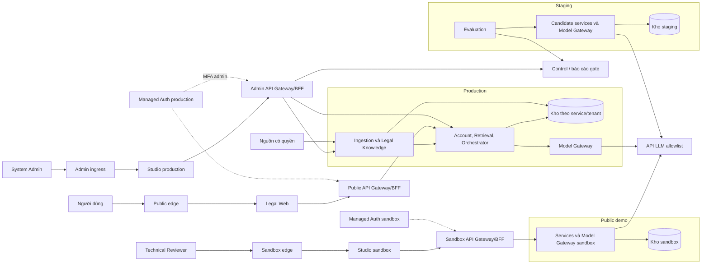

# 03. System Architecture Document

Phiên bản 0.2 · 26/11/2026 · Danh mục repo đã chốt theo ADR-01 (G0)

## Hệ thống và container

Web và Studio dùng React, Vite, TypeScript. Python/FastAPI triển khai các service trong catalog. Sơ đồ này là topology chuẩn cho mô hình bảo mật và triển khai. API Gateway/BFF là lớp kiểm xác thực, điều phối API và chuyển SSE thuộc lớp triển khai của Web/Studio, chưa phát sinh repository thứ 17. Từng service vẫn thực thi quyền theo tenant và tài nguyên.

Evaluation gọi Retrieval và Orchestrator ứng viên trong staging, dùng manifest đã pin và gửi báo cáo qua Control. Studio production nhận báo cáo đã lọc qua Control. Studio sandbox chạy suite mẫu trên stack riêng. BFF sandbox có issuer, audience, secret và state riêng. Admin ingress chỉ nhận session admin đã MFA. Kho chat thuộc Account & Workspace. Nguồn đi qua vùng cách ly của Ingestion. Đường tới provider ở mỗi môi trường đều qua Model Gateway của môi trường đó. [Threat model](08-security-threat-model.md#dữ-liệu-và-ranh-giới-tin-cậy).

## Danh mục polyrepo đề xuất

DEC-07 yêu cầu tạo skeleton private cho toàn bộ danh mục sau khi phê duyệt SAD. Service LATER có contract và mô tả vòng đời ngay khi khởi tạo repo. Triển khai tính năng theo các gate tương ứng.

| Repo chính thức (`github.com/WindFaculty`) | Phạm vi triển khai | Quyền ghi hoặc đầu ra chính |
|---|---|---|
| `LuatVN-AI-account-workspace` | V1 | Membership, session scopes, conversation, feedback, consent |
| `LuatVN-AI-legal-knowledge` | V1 | Legal versions, taxonomy, assertion/edge và rule registry, snapshot manifest |
| `LuatVN-AI-data-ingestion` | V1 | Source metadata, checkpoints, raw/quarantine objects, validation reports |
| `LuatVN-AI-retrieval` | V1 | Các chỉ mục dẫn xuất, truy vấn và xếp hạng |
| `LuatVN-AI-ai-orchestrator` | V1 | Answer envelope, run state và verification report. Lịch sử bền vững qua Account |
| `LuatVN-AI-model-gateway` | V1 | Approved routes, quota reservations, usage ledger và provider policy |
| `LuatVN-AI-evaluation` | V1 | Dataset, nhãn review, kết quả, gate report |
| `LuatVN-AI-document-intelligence` | LATER | Hồ sơ tải lên và bản phân tích theo tenant |
| `LuatVN-AI-legal-monitoring` | LATER | Theo dõi, subscription và gửi thông báo |
| `LuatVN-AI-billing-enterprise` | LATER | Billing, bổ sung entitlements và policy doanh nghiệp qua contract |
| `LuatVN-AI-community` | LATER | Đóng góp, điều tiết nội dung, đưa ứng viên vào kiểm duyệt |
| `LuatVN-AI-web` | V1 | Web tra cứu và chat |
| `LuatVN-AI-studio` | V1 | Studio sandbox và bản triển khai production riêng |
| `LuatVN-AI-mobile` | LATER | Android/iOS, dùng chung API versioned |
| `LuatVN-AI-control` | V1 | Tài liệu, ADR, IaC, integration tests, release manifest và CI templates |
| `LuatVN-AI-contracts` | V1 | OpenAPI/event schemas, SDK/types và kiểm tra tương thích |

Initial commit mỗi repo gồm README ranh giới, owner, contract version, CI tối thiểu, cách chạy test, policy secret và check tương thích. Ghi namespace, visibility, default branch và commit vào inventory khi tạo. Namespace Git (`github.com/WindFaculty`) và package registry (GitHub Packages/GHCR) đã chốt theo [ADR-01](adr/ADR-01-polyrepo-catalog.md).

Trong commit đầu của `LuatVN-AI-contracts`, pin phiên bản codegen TypeScript/Pydantic, kiểm kiểu sinh, JSON Schema runtime và payload frame SSE, rồi chặn CI khi kiểm tra thất bại. [Lệnh và fixture](contracts/README.md).

## Meta-workspace cho polyrepo

Checkout các repo V1 thành thư mục anh em dưới một thư mục làm việc. Repo `LuatVN-AI-control` sở hữu manifest pin repo/ref và revision của `LuatVN-AI-contracts`, cách đồng bộ và lệnh kiểm tra tích hợp. Các repo LATER được checkout khi task cần. Có thể đọc repo liên quan theo quyền. Task contract liệt kê repo được phép sửa. Script sync dự kiến kiểm trạng thái checkout, xác minh revision, tạo SDK/types vào thư mục generated hoặc gói versioned và báo sai lệch. Chế độ CI kiểm kết quả và chặn drift. Chế độ cập nhật tôn trọng worktree đang sửa và manifest phải được review trước khi nâng pin. Repo vẫn có lịch sử Git và pipeline riêng. [Quy trình thay đổi xuyên repo](13-ai-coding-agent-guidelines.md#thay-đổi-contract-xuyên-repo).

## Luồng và hợp đồng liên service

| Handoff | Hợp đồng đề xuất | Tính nhất quán |
|---|---|---|
| Ingestion → Legal Knowledge | `CandidateVerified.v1` chứa event ID, canonical identity, artifact hash và review evidence | Outbox giao ít nhất một lần. Consumer idempotent theo event ID và optimistic revision |
| Knowledge → Retrieval | `SnapshotReady.v1` chứa manifest, version refs, taxonomy, graph/rule revision | Build index song song, kiểm checksum rồi promote alias gắn snapshot. Query pin cùng snapshot tới hết request |
| Web/Studio → Services | OpenAPI, actor/context suy từ credential đã xác thực, idempotency key cho POST có hiệu ứng | Kiểm quyền ở từng service. TLS, service identity, request ID, deadline, pagination cho list |
| Orchestrator → Retrieval/Knowledge | `EvidenceQuery.v1` gồm thời điểm pháp lý, recorded cutoff, scope, snapshot, `query_vi` và filters. Có thể gửi cặp `query_original`/`query_language` nếu Retrieval cần truy vấn gốc | Trả danh sách provision version và evidence anchors. Rule/graph dùng cùng snapshot |
| Orchestrator → Gateway | `ModelRequest.v1` gồm purpose, data class, quota reservation, timeout, model config ID | Chỉ egress qua allowlist. Kết toán thành công, lỗi hoặc hủy dựa trên usage thật. Reconcile lượt chưa rõ |
| Evaluation → Control | `GateReport.v1` chứa metric, denominator, CI khi phù hợp, số case S0/S1 riêng theo scope và artifact digests | Report phê duyệt gắn manifest. Bất kỳ digest khác cần chạy lại gate liên quan |

Relational PostgreSQL lưu dữ liệu nghiệp vụ theo ownership. Vector, keyword và graph có thể cùng hoặc khác engine và phải tái tạo từ nguồn chuẩn. Object store lưu bytes bất biến và chế độ truy cập theo loại dữ liệu. [Mô hình sở hữu và lưu trữ](06-database-design.md).

Các schema dưới đây là đầu vào đề xuất cho `LuatVN-AI-contracts`. `CandidateVerified.v1`, `SnapshotReady.v1` và `GateReport.v1` là event bất đồng bộ dùng outbox chung transaction với state, delivery ít nhất một lần và consumer inbox dedup theo ID. Giữ thứ tự cần thiết theo aggregate revision, bỏ qua revision cũ, retry và giữ DLQ có quyền replay. Kích hoạt alias hoặc promotion khi digest và trạng thái staging khớp. `EvidenceQuery.v1` và `ModelRequest.v1` là request–response có deadline, truyền bằng HTTPS nội bộ có xác thực workload và scope do server cấp. Retry ModelRequest dùng cùng request ID và quota reservation để tránh kết toán trùng. `prompt_ref` trỏ vật liệu tạm có phân quyền và TTL để Gateway đọc sau khi policy cho phép. Log ghi metadata đã che. [OpenAPI](contracts/answers.openapi.yaml) · [JSON Schema cho 5 hợp đồng nội bộ](contracts/internal-v1.schema.json).

## ADR cần quyết định

| ADR | Quyết định | Mốc |
|---|---|---|
| [ADR-01](adr/ADR-01-polyrepo-catalog.md) | Catalog 16 repo `WindFaculty/LuatVN-AI-*` (PRIVATE) và registry GitHub Packages/GHCR | Đã chốt tại G0 (26/11/2026) |
| ADR-02 | Lưu trữ vật lý, index và projections | G1–G3 theo PoC |
| ADR-03 | AI stack, adapters và model routing | G1–G4 theo PoC |
| ADR-04 | Cloud, region, managed auth và recovery | Quyết định trước promotion G6 |
| [ADR-05](adr/ADR-05-studio-sandbox.md) | Studio sandbox: chung project tách cứng IAM/DB/Auth/Gateway, demo invite/CV + anti-bot/rate limit, reset tuần + nút Reset | Đã chốt thiết kế G0 (26/11/2026), kiểm vận hành ở G6 |
| ADR-06 | Holdout, review L2/L3, gate toàn tập/domain/cell | Khóa giao thức trước khi chọn model, nghiệm thu tại G5 |

[Trạng thái, lựa chọn và điều kiện quyết định ADR](registers.md#adr).

[Căn cứ baseline §§6, 8–9 và 14–16](../../Luat_Viet_Nam_AI_Requirements_Baseline_v1.0.md)
