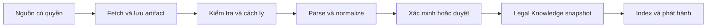

# 05. Data Engineering Specification

Phiên bản 0.2 · 26/11/2026 · Cấu hình nguồn chờ POC-01

## Danh mục nguồn và taxonomy

[Data Source Registry](registers.md#data-source-registry) ghi cổng nguồn, mục đích truy cập và việc phải kiểm chứng cho từng nguồn. Ưu tiên catalog chính thức và artifact gốc đối chiếu. Quyền được duyệt riêng cho truy cập tự động, lưu, lập chỉ mục, trích dẫn, tải và phân phối. Chỉ sử dụng nguồn theo mục đích được duyệt. Adapter có chủ sở hữu, lịch sử policy, rate limit, cách liên hệ và điều kiện dừng.

Taxonomy gắn nhãn lĩnh vực độc lập với ba danh mục loại văn bản, cơ quan và địa bàn. Chín nhóm pilot G1 gồm dân sự, hình sự, hành chính/tư pháp, lao động/an sinh, đất đai/nhà ở, kinh doanh/thuế, giao thông, giáo dục/y tế và môi trường. POC-01 đối chiếu với danh mục gốc và ghi sub-domain cho chuyên ngành nhỏ. Khi đề xuất nâng sub-domain lên cấp 1, ghi bằng chứng coverage và kế hoạch mẫu/reviewer từ POC-11. Chuẩn hóa mã ổn định theo revision, ghi đa nhãn và ánh xạ tên cũ. Tử số bao phủ là record hợp lệ đã đối chiếu ở snapshot. Mẫu số là số record trong từng catalog/lĩnh vực/loại/cấp/địa bàn được ghi nguồn. Mẫu số thiếu báo `unknown` cùng lý do. Dự thảo, tài liệu hết hiệu lực, tương lai đã ban hành, bản hợp nhất, quyết định tư pháp và bản dịch có phân loại riêng.

### Kênh nguồn và dữ liệu lịch sử

- SRC-02 trả 403 trong lần kiểm G0 v0.1. Xác minh kênh catalog, API/feed hoặc batch của cơ quan chủ quản và quyền từng hành động. Trong thời gian chờ, dùng Công báo hoặc cổng cơ quan đã được duyệt cho tài liệu giao nhau, ghi riêng phần coverage còn thiếu.
- SRC-05 timeout trong lần kiểm G0 v0.1. Kiểm đầu mối công bố và kênh batch được phép. Nếu chưa xác nhận quyền với bản án, chỉ dùng fixture synthetic hoặc tài liệu tư pháp công khai đã được duyệt cho mục đích tương ứng. Gắn trạng thái thiếu phạm vi bản án. Không retry vô hạn với nguồn trả 403/timeout, lưu nguyên nhân và quyết định từ sổ nguồn.
- Công văn hướng dẫn lưu loại, cơ quan, người nhận/phạm vi, trích yếu, nguồn gốc và cạnh `guides` có provenance. Dùng binding/applicability theo rule đã xác minh. Địa danh lịch sử tra qua lineage sáp nhập/chia tách/đổi tên gắn nguồn và thời gian, giữ cảnh báo nếu phạm vi còn tranh chấp. [Data Source Registry](registers.md#data-source-registry) · [Mô hình lineage](06-database-design.md#sửa-đổi-hợp-nhất-và-địa-giới).

## Pipeline và lineage

1. Discover theo adapter API/crawler/batch được duyệt. Lưu cursor theo nguồn, checksum và thời điểm fetch, response metadata và URL canonical. Dùng conditional fetch khi nguồn hỗ trợ. Source error có classification, retry hữu hạn có jitter, checkpoint và hàng chờ xử lý lỗi.
2. Lưu raw object bất biến theo hash, MIME thực, kích thước, chữ ký nếu có và source revision. Tải lên của người dùng, khi triển khai, vào khu cách ly riêng, xác minh quyền và quét trước khi được phép xử lý.
3. Parse HTML, PDF text, PDF scan, ảnh, DOC/DOCX và spreadsheet theo adapter. Table extraction giữ row/column/header, merge, formula và chú giải. OCR lưu page geometry và confidence theo dòng. Phụ lục/biểu mẫu gắn parent và anchor. Ghi version adapter/parser/OCR và bản đồ normalized offsets → trang/HTML/ô nguồn.
4. Normalize identity theo cơ quan, loại, số ký hiệu, năm và thông tin phân giải. Content hash giúp phát hiện byte trùng, vẫn giữ từng provenance. Hai nguồn khác nhau về văn bản, bản ký, thời điểm hoặc điều khoản thì ghi conflict và đưa người duyệt.
5. Validation kiểm hierarchy, date ordering, ngày chưa biết, số điều trùng trong cùng ngữ cảnh, link amendments, ký hiệu, checksum và mẫu so artifact gốc. Machine check tạo hồ sơ ứng viên. Bất thường, mâu thuẫn hoặc hiệu lực chưa rõ chờ duyệt thủ công. Tài liệu được phép tra cứu khi chưa xác minh mang cảnh báo và filter loại khỏi evidence.
6. Publish snapshot từ nguồn đã duyệt. Outbox tạo manifest và reindex. Tiến trình build và tiêu thụ event idempotent theo source revision, artifact, pipeline version hoặc event ID. Index giữ embedding version. Promotion kiểm replay, parity và số bản ghi. Lỗi index giữ alias đã duyệt đang hoạt động.

## Chất lượng và vận hành

| Phép đo | Đơn vị và bằng chứng |
|---|---|
| Metadata completeness và coverage | Field hợp lệ trên field bắt buộc, document đã đối chiếu trên catalog counted theo strata |
| OCR và structure | CER/WER trên mẫu đã chép, precision/recall cho node và quan hệ cha–con, kiểm ô/cột/hàng và anchor |
| Dedup và temporal relations | Tỷ lệ merge đúng/sai trên cụm review. Kiểm amendment, repeal, transition và hiệu lực một phần |
| Freshness và reliability | Timestamp discover → verify → active index, retry/fail/cursor lag trên lô theo nguồn |
| Sizing | Bytes raw và normalized/document, số chunks và index amplification, backup/egress growth |

POC-01 tạo mẫu theo nguồn/loại/cấp/địa bàn/thời kỳ và xác nhận quyền. POC-02 đo ngay trên gold samples nhiều định dạng. Chủ dự án phê duyệt ngưỡng, mẫu số và hành vi khi fail trước G1. Bản dịch AI giữ liên kết nguyên bản và nhãn. Bản dịch chính thức lưu source revision riêng.

[Căn cứ baseline §5 và POC-01–02](../../Luat_Viet_Nam_AI_Requirements_Baseline_v1.0.md)
