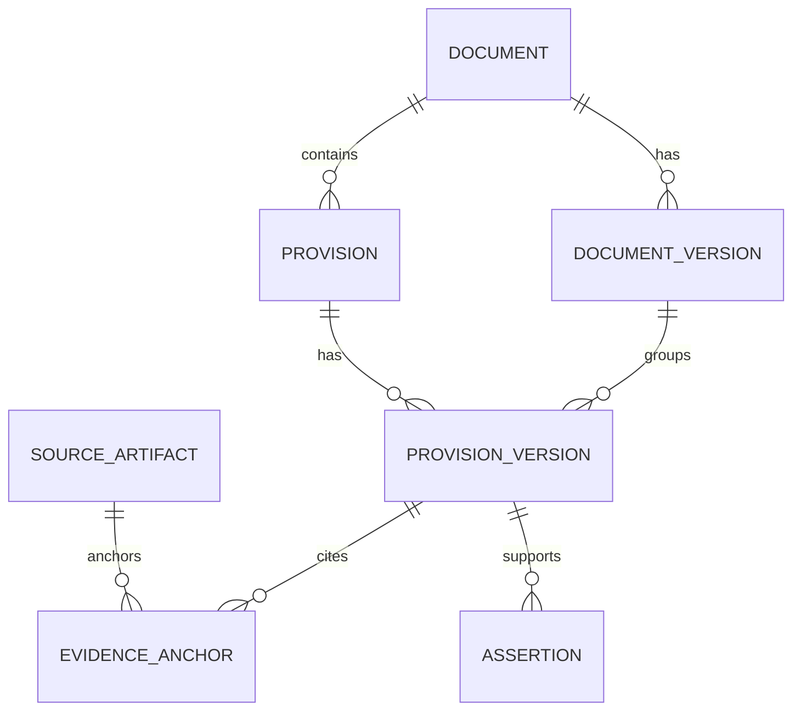

# 06. Database Design

Phiên bản 0.2 · 26/11/2026 · Thiết kế logic, vật lý chờ PoC

## ERD và kho chuẩn

| Nhóm | Khóa và dữ liệu chính |
|---|---|
| Document và DocumentVersion | Stable document UUID, typed canonical identity, issuer/jurisdiction, official number, policy trạng thái, valid/recorded ranges và source revision |
| Provision và ProvisionVersion | Stable provision UUID, document ID, parent hoặc historical path theo version, số điều/khoản/điểm, text hash, bitemporal ranges và verification ref |
| SourceArtifact và EvidenceAnchor | Artifact ID, hash/URL/fetch/revision/parser. Anchor có exact quote, offset/trang, proof role và kiểm tra khớp |
| Assertion và relation | Assertion ID, source/target và kind, version, bitemporal, provenance refs, review state, conflict set |
| Rule và snapshot | Rule family/version, compiled condition, precedence/unknown result, evidence và review. Snapshot pin corpus, index, taxonomy, rules, graph, policy và recorded cutoff |
| Workspace và vận hành | Account sở hữu membership, conversation, feedback. Gateway sở hữu reservations/usage. Ingestion sở hữu job/checkpoint. Evaluation sở hữu split/case/review/run |

## Bitemporal và cập nhật

Dùng nửa mở `[valid_from, valid_to)` theo ngày pháp lý và `[recorded_from, recorded_to)` theo timestamp có timezone. Ranh giới chưa biết là trạng thái riêng với lý do. `valid_to` mở chỉ khi trạng thái đã xác minh cho phép. Mỗi query cho AI chọn record có cả ngày và recorded cutoff thuộc hai khoảng, cùng manifest và domain scope. Phiên bản draft, binding class đặc thù và unresolved conflict đi theo policy, không gán ưu tiên theo similarity.

Ví dụ giả lập, một khoản có hiệu lực sửa đổi từ 01/05, nhưng thông tin mới được xác minh ngày 10/05. Một truy vấn ngày pháp lý 05/05 với recorded cutoff 06/05 tái hiện dữ liệu phiên bản trước tại thời điểm đó. Cùng ngày pháp lý với cutoff 11/05 truy xuất revision sửa đổi đã ghi nhận nếu đủ căn cứ. Phạm vi áp dụng cụ thể có thể cần kiểm transition rule. Có thể xử lý các khoản khác trong cùng điều với hiệu lực riêng.

Đóng recorded range của assertion cũ và append revision mới cùng transaction với outbox. Writer khóa các assertion đang mở của cùng canonical key và scope theo thứ tự nhất quán trước khi chia lại đoạn, hoặc chạy transaction serializable và retry lỗi cạnh tranh. DDL minh họa dùng `btree_gist` và `EXCLUDE USING gist (canonical_key WITH =, scope_key WITH =, valid_range WITH &&, recorded_range WITH &&) WHERE (review_state = 'verified')`. Hai đoạn đã xác minh cùng key và scope chỉ xung đột khi giao ở cả hai trục thời gian. Candidate/conflict có thể đồng tồn tại để duyệt. Phân giải scope chồng lấp, revision và quyền publish ở Legal Knowledge trước khi ghi. Thu hồi nguồn lỗi dùng deny revision để chặn cả snapshot đang chạy khi cần và đánh giá lại ảnh hưởng. [DDL PostgreSQL mẫu](examples/temporal-example.sql) · [PostgreSQL range types](https://www.postgresql.org/docs/current/rangetypes.html) · [btree_gist](https://www.postgresql.org/docs/current/btree-gist.html).

## Sửa đổi, hợp nhất và địa giới

| Trường hợp | Biểu diễn và kiểm tra |
|---|---|
| Chèn Điều 5a hoặc Khoản 2a | Cấp provision ID riêng, giữ nhãn văn bản và khóa thứ tự độc lập. Gắn đúng cha, thứ tự theo revision và evidence anchor. Khi đánh lại số, revision ghim nhãn cũ/mới vào cùng ID nếu là cùng điều khoản đã xác minh |
| Một luật sửa nhiều luật | Mỗi `AMENDMENT_OPERATION` trỏ điều khoản sửa đổi và mục tiêu thuộc một văn bản. Một điều khoản nguồn có thể có nhiều operation có thứ tự, hiệu lực hoặc điều kiện chuyển tiếp riêng |
| Sửa, bãi bỏ hoặc đính chính một cụm từ | Xác nhận target version và exact span bằng anchor hoặc offset. Lưu operation cùng before/after version, locator và evidence. Nếu không xác định được đoạn hoặc có nhiều đoạn trùng, chuyển review và giữ trạng thái conflict |
| Văn bản hợp nhất | `CONSOLIDATION_LINEAGE` nối version hợp nhất tới các version đóng góp và operation nếu có. Giữ loại văn bản và provenance độc lập, truy ra văn bản gốc/sửa đổi khi chọn căn cứ |
| Sáp nhập, chia tách, đổi tên hoặc điều chỉnh địa giới | `jurisdiction_label_revision` lưu tên/mã theo thời gian. `jurisdiction_lineage` nối ID từ–đến theo loại, valid range và recorded range. Một sáp nhập/chia tách có nhiều cạnh. Đổi tên có thể giữ ID nếu nguồn xác nhận tính liên tục. Nếu chỉ biết tên cũ mà chưa rõ địa bàn áp dụng, truy xuất đánh dấu thiếu dữ kiện |

Migration G1 dùng khóa ghép để giữ cha–con cùng văn bản và assertion–anchor cùng phiên bản. Hai trục thời gian của label và lineage đều yêu cầu cận dưới hữu hạn. Kiểm chồng lấn trên hàng `verified` theo địa bàn đối với label và theo bộ (địa bàn nguồn, địa bàn đích, loại quan hệ) đối với lineage. Candidate/conflict có thể lưu cùng khoảng để duyệt. Nhiều cạnh đích của một lần chia tách vẫn hợp lệ. Chạy fixture ràng buộc khi áp migration. Test G3 dùng fixture giả lập và provenance từ nguồn được phép để kiểm nghiệp vụ tại service, gồm chu trình cha–con/lineage, quote khớp anchor, scope resolution, ngày chưa rõ và xác minh quan hệ. [DDL PostgreSQL mẫu](examples/temporal-example.sql) · [Fixture PostgreSQL](examples/temporal-example.test.sql).

## Hai tầng graph và quyền ghi

| Tầng | Node, edge và phạm vi | Bằng chứng AC-12 đề xuất |
|---|---|---|
| Structural / Citation | Document, Provision, ProvisionVersion, Authority, Jurisdiction. Edge `modifies`, `replaces`, `repeals`, `guides`, `corrects`, `references`. Pipeline deterministic/bán tự động chạy trên toàn corpus được nhận và có quyền | Đo tỷ lệ corpus được pipeline xử lý, precision/coverage theo loại cạnh qua mẫu đã audit, diff theo snapshot và replay truy vấn. Tỷ lệ xử lý corpus và độ đầy đủ cạnh là hai số riêng |
| Deontic / Normative | Subject, Right, Obligation, Condition, Exception. Edge `applies_to`, `grants`, `imposes`, `conditioned_by`, `excepted_by`. Toàn bộ ontology và pipeline kiểm chứng trên tập văn bản lõi có gold set, sau đó mở rộng theo evidence | G1 chốt phạm vi lõi và mẫu số theo domain/type. G3 chạy pipeline trích xuất, duyệt, versioning, edge provenance và multi-hop. Báo precision/coverage theo node/edge, domain và loại nguồn. Chỉ dùng cạnh đã xác minh |

Mỗi assertion trỏ provision version và anchor, có hai trục thời gian, reviewer và trạng thái. Legal Knowledge là writer duy nhất của ontology đã duyệt. Graph store tách là projection của snapshot. Graph có schema nhưng thiếu pipeline hoặc gold evidence chưa đạt AC-12. Phạm vi, ngưỡng và nguồn lực thực tế chốt qua G1/G3 theo baseline, giảm phạm vi đã duyệt cần change control. [Rule Engine](04-ai-rag.md#rule-engine-và-hai-lớp-quy-tắc).

## Năng lực lưu trữ và phương án vật lý

| Năng lực | Phương án A | Phương án B | Dữ liệu/kiểm tra quyết định |
|---|---|---|---|
| Relational PostgreSQL | Cụm theo môi trường, DB/schema và writer role theo service | PostgreSQL managed tách theo tải/trust boundary | Transaction, deny quyền ghi chéo, backup/PITR/restore |
| Vector | pgvector | Qdrant hoặc vector managed | Recall ở cùng filter/time snapshot, reindex, memory, p95 |
| Keyword | PostgreSQL exact-key + FTS cấu hình `simple`. Đối chứng `unaccent`/`pg_trgm` và tiền xử lý tách từ VI | BM25 qua OpenSearch với analyzer VI được kiểm chứng hoặc engine tương đương | Chất lượng tiếng Việt, exact số hiệu, nDCG, vận hành |
| Graph | Relationship tables với traversal có giới hạn | Neo4j hoặc graph managed | Precision/coverage, edge replay, latency theo hop |
| Object storage | S3-compatible local để kiểm thử | Managed object store GCS/R2 theo region/quyền | Immutability, checksum, lifecycle, egress, encryption và restore |

Ứng viên PostgreSQL dùng B-tree cho canonical identifiers, GiST cho time ranges và GIN cho trường text search nếu chọn FTS. `simple` làm mốc đối chứng, không giả định giải được cụm từ tiếng Việt nhiều âm tiết. Giữ nguyên văn có dấu để làm nguồn và một trường đã chuẩn hóa để mở rộng truy vấn. POC-03 đối chứng query dấu/không dấu, Điều 5a, cụm pháp lý nhiều tiếng, số ký hiệu có gạch/slash và địa danh cũ. Đo Recall/nDCG, false match, P95 và chi phí reindex theo cùng snapshot, không ghi đè đường tìm chính xác số hiệu. Kiểm query plan, migration, concurrency, reindex và restore. FK dùng trong DB cùng ownership. Liên service lưu ID opaque và kiểm qua contract. [PostgreSQL pg_trgm](https://www.postgresql.org/docs/current/pgtrgm.html) · [PostgreSQL unaccent](https://www.postgresql.org/docs/current/unaccent.html).

[Căn cứ baseline §5.2, REQ-ARCH-03 và POC-04–05](../../Luat_Viet_Nam_AI_Requirements_Baseline_v1.0.md)
