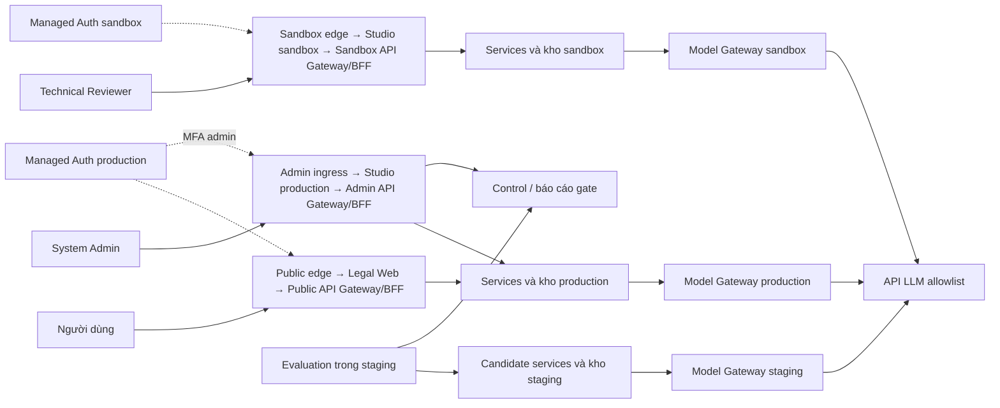

# 08. Security Architecture & Threat Model

Phiên bản 0.2 · 26/11/2026 · Thiết kế kiểm soát, chờ đánh giá G6

## Dữ liệu và ranh giới tin cậy

Nguồn Internet đi qua adapter, kiểm malware và parser sandbox trước canonical store. Artefact untrusted, chat/PII và material nội bộ thuộc các lớp dữ liệu khác nhau. Credential production để trong secrets manager và tách theo workload/environment. Dữ liệu được mã hóa khi truyền và khi lưu, quản lý khóa và rotation tập trung. Nội dung nhạy cảm có chính sách mã hóa theo trường nếu đánh giá yêu cầu.

Sơ đồ luồng dữ liệu dùng cùng các entrypoint và ranh giới với [topology trong SAD](03-sad.md#hệ-thống-và-container). Kho, issuer, audience và service identity của sandbox tách biệt. Báo cáo Evaluation đi qua Control, giữ quyền xem theo môi trường. Public BFF tiếp nhận câu hỏi, hủy và feedback theo scope người dùng. Tool agent ở Legal Web chỉ đọc kho đã xác minh, và không nhận credentials của Admin BFF hoặc Studio sandbox.

Dùng managed auth với email/password, Google OAuth, phone OTP. MFA cho admin và expert, tùy chọn người dùng theo baseline. Service xác minh issuer, audience, expiry và actor. Scope RBAC gắn với ABAC theo tenant, quan hệ sở hữu, hành động, môi trường, risk và consent. Filter deny-by-default tại API/DB/index/object/cache. Service-to-service dùng workload identity và audience theo đích, cấm tái sử dụng token sandbox với production.

## Threat register và checks

| ID | Nguy cơ | Kiểm soát và kiểm thử phòng thủ |
|---|---|---|
| T-01 | Đọc chéo tài khoản hoặc tenant | Áp quyền tại mọi truy vấn và cache key. Kiểm tra truy cập A/B qua API, DB, index, object, cache, logs và event replay |
| T-02 | Dữ liệu tải lên gây lỗi hoặc trộn vào corpus | Quarantine, MIME/size/decompression limits, scanner và parser cô lập quyền ghi/egress. Kiểm mẫu synthetic an toàn và từ chối trước publish |
| T-03 | Nội dung nguồn điều khiển agent hoặc làm lộ dữ liệu | Tách instructions/evidence, kiểm tool ACL và schema, policy trước mọi action. Kiểm từ chối thay đổi dữ liệu hoặc egress ngoài scope |
| T-04 | Provider nhận dữ liệu ngoài quyền hoặc retention | Data class + minimization/redaction, eligibility trước routing/fallback, egress allowlist, ledger vết đã che. Kiểm no-call khi deny |
| T-05 | Lộ log/trace, secrets hoặc production controls | Redaction trước lưu, trường log allowlist, RBAC, audit, secret scan, riêng sandbox identity và datasets. Kiểm bundle/UI/API/logs với secret canary giả |
| T-06 | Cạn ngân sách, abuse hoặc bot | Rate limit, anti-bot, anomaly alerts, quota nguyên tử request/account/platform, reservation/reconcile, cancel runaway agent. Kiểm race và failure |
| T-07 | Tài liệu, rule hoặc release bị sửa không duyệt | Phê duyệt, hash/version manifests, audit integrity, signer quyền hẹp và rollback có record. Kiểm promotion sai và restore |
| T-08 | Kết luận rủi ro cao hoặc trích dẫn vô hiệu | Evidence gate, risk routing, needs reviewer flag, khóa cell lỗi, kiểm high-risk và correction replay |
| T-09 | Mất dữ liệu hoặc thao tác retention sai | Backup/PITR, restore drill, quyền giới hạn, lịch xóa và phục hồi có kiểm tra tombstone. Kiểm RPO/RTO thực đo |
| T-10 | Chỉ dẫn gián tiếp nằm trong văn bản công khai, OCR hoặc bản án | Xem nội dung truy xuất là dữ liệu kể cả khi nguồn đã xác minh. Dùng fixture vô hại chứa đề nghị giả lập vượt scope hoặc tiết lộ canary. Kiểm tool ACL, không phát sinh egress ngoài policy và vẫn giữ trích dẫn nếu claim có căn cứ hợp lệ |

SAST, dependency/secret scan, DAST phòng thủ và AI red-team theo scope được duyệt. Kiểm riêng data-plane và management-plane. Trong Studio, mọi thao tác agent đề xuất có hiệu ứng ngoài hoặc ghi dữ liệu phải đi qua API theo role và approval gắn actor, môi trường và hash input, có thời hạn và audit. Public sandbox giới hạn ghi trên dữ liệu demo trong namespace riêng, có quota, expiry và reset. Production admin thực hiện theo quy trình phê duyệt riêng.

## Privacy và thẩm định phát hành

| Dữ liệu | Chủ sở hữu và xử lý | Quyết định trước phát hành |
|---|---|---|
| Public legal artifacts | Legal Knowledge/Ingestion, nguồn và quyền phân phối theo registry | Duyệt đối chiếu quyền, án/bản án có PII và public download |
| Chat, hành vi và hồ sơ riêng | Account & Workspace, cô lập tenant, kiểm truy cập/xóa và đồng ý mục đích cải thiện AI | Chốt age policy, consent, retention và data rights workflow. Private mode cần đủ policy provider, trace, cache và backup |
| Gateway usage và trace | Gateway/Orchestrator, dữ liệu tối thiểu, redact giá trị nhạy cảm | Provider/region, cross-border, retention, mục đích và phê duyệt riêng |
| Audit và backup | Service owner, integrity và quyền ops tách biệt | Thời hạn theo loại dữ liệu, xử lý deletion sau restore, key rotation và diễn tập |

Lập data inventory và bản đồ xử lý/region, đánh giá căn cứ xử lý, tuổi, chuyển dữ liệu và quyền nguồn theo flow thực tế. Xác định phân loại rủi ro AI, nghĩa vụ thông báo, điều khoản/notice, tiếp nhận yêu cầu dữ liệu, cơ chế đính chính và incident response. G6/G7 cần checklist có nguồn, phiên bản, phạm vi, kết luận người có thẩm quyền và evidence. Khi phát hiện rò rỉ hoặc lỗi nghiêm trọng, khóa phạm vi, giữ chứng cứ theo policy, xác định ảnh hưởng, xử lý thông báo nếu áp dụng, sửa, tái kiểm và duyệt mở lại. Đánh giá độc lập thuộc G8.

Nguồn pháp lý để lập checklist thẩm định. [Luật 91/2025/QH15](https://vanban.chinhphu.vn/?docid=214590&pageid=27160) · [Nghị định 356/2025/NĐ-CP](https://chinhphu.vn/?docid=216387&pageid=27160) · [Luật 134/2025/QH15](https://vanban.chinhphu.vn/?docid=216334&pageid=27160&typegroupid=3) · [Nghị định 142/2026/NĐ-CP](https://vanban.chinhphu.vn/?docid=218029&pageid=27160).

[Căn cứ baseline §9, POC-10 và G6–G8](../../Luat_Viet_Nam_AI_Requirements_Baseline_v1.0.md)
